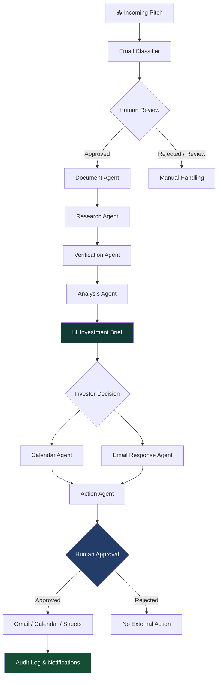
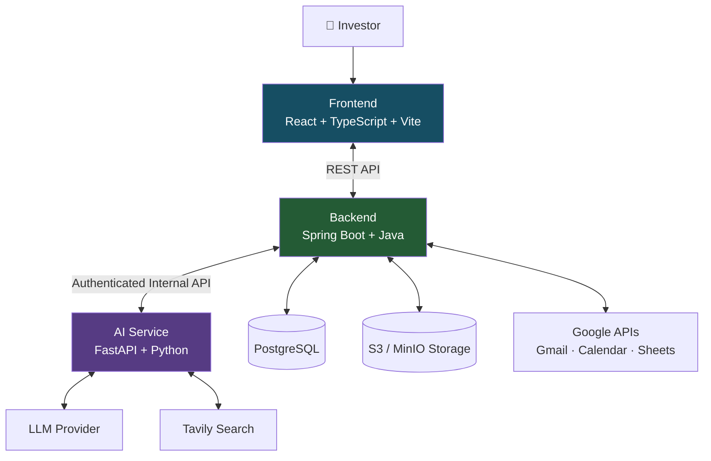

# Pitsch — AI-Powered Investment Workflow Automation

<div align="center">


### Transforming startup pitches into structured, evidence-backed investment intelligence.

[](https://react.dev/)
[](https://www.typescriptlang.org/)
[](https://spring.io/projects/spring-boot)
[](https://python.org/)
[](https://fastapi.tiangolo.com/)
[](https://postgresql.org/)

<br/>

**[Explore the Repository](#-getting-started) · [Architecture](#-system-architecture) · [AI Agents](#-the-eight-ai-agents) · [Documentation](#-documentation)**

<br/>

</div>

---

## 💡 What is Pitsch?

Pitsch is an AI-powered investment workflow platform designed for **investors, venture capital firms, accelerators, and investment teams**.

Investment teams receive hundreds of startup pitches through email. Evaluating each opportunity involves reading pitch decks, researching companies, verifying founder claims, understanding market positioning, and managing communication.

Pitsch brings this entire workflow into one intelligent platform.

It automatically identifies incoming pitches, extracts information from documents, researches companies, verifies claims against external evidence, and generates structured investment briefs.

But there's one important principle:

> **AI provides intelligence. Humans make investment decisions.**

Pitsch does not make investment recommendations or automatically decide whether a startup deserves funding. It equips investors with structured information, evidence, risks, and questions so they can make informed decisions.

## ✨ Key Features

| Feature | Description |
|---|---|
| 📥 Intelligent Inbox | Import startup pitches manually or ingest emails through Gmail integration. |
| 🧠 AI Classification | Identify new pitches, follow-ups, updates, and irrelevant emails. |
| 📄 Document Intelligence | Extract company information, founders, fundraising details, metrics, and claims from PDF/PPTX decks. |
| 🌐 Automated Research | Research companies and collect external evidence using web search. |
| 🔍 Claim Verification | Cross-check founder claims against collected evidence. |
| 📊 Investment Briefs | Generate structured, evidence-backed company analysis. |
| 📅 Smart Scheduling | Suggest meeting slots based on calendar availability and working hours. |
| ✉️ AI Email Drafting | Generate contextual email replies that investors can review and edit. |
| 🔄 Deal Pipeline | Track pitches, deal stages, tasks, activities, and follow-ups. |
| 🔐 Human Approvals | Require human approval before consequential external actions. |
| 📋 Audit Logging | Maintain traceable records of workflows and external actions. |
| 🔔 Notifications | Receive workflow updates and important activity notifications. |

## 🤖 The Eight AI Agents

Pitsch uses a multi-agent architecture in which specialized AI agents handle individual stages of the investment workflow.

Each agent has a specific responsibility and returns structured, schema-validated output.

| # | AI Agent | Responsibility |
|---|---|---|
| 01 | Email Classifier | Classifies incoming emails and identifies new pitches, follow-ups, and updates. |
| 02 | Document Agent | Extracts company information, founder details, fundraising information, metrics, and claims from pitch decks. |
| 03 | Research Agent | Performs external research and collects relevant evidence from web sources. |
| 04 | Verification Agent | Evaluates claims against collected evidence and identifies unsupported or contradictory statements. |
| 05 | Analysis Agent | Generates a comprehensive investment research brief with risks, opportunities, and missing information. |
| 06 | Calendar Agent | Suggests suitable meeting slots based on availability and working hours. |
| 07 | Email Response Agent | Generates contextual email drafts for investor communication. |
| 08 | Action Agent | Prepares structured actions for Gmail, Calendar, and Sheets integrations, including approval requirements. |

### Agent Workflow



### What makes the architecture different?

- **Specialization:** Each agent handles a clearly defined task.
- **Structured Outputs:** Agent responses are validated against predefined schemas.
- **Evidence-Based Analysis:** Claims are evaluated using collected evidence rather than relying solely on model knowledge.
- **Resumable Workflows:** Successful agent executions are persisted, allowing failed workflows to resume without repeating completed steps.
- **Controlled Execution:** AI agents suggest actions, while the backend validates and executes approved operations.
- **Traceability:** Agent executions track model information, token usage, latency, estimated cost, and execution status.

---

## 🏗️ System Architecture

Pitsch follows a modular three-service architecture.



### Architecture Components

**1. Frontend — `frontend/`**

Built using React 19 and TypeScript.

- Component-based UI architecture.
- React Router for navigation.
- Typed API client.
- Authentication context.
- Dashboard, inbox, pitches, workflows, pipeline, calendar, tasks, and notifications.

**2. Backend — `backend/`**

Built using Java 21 and Spring Boot 3.5.

The backend is the central orchestration and security layer.

- REST API development.
- Authentication and authorization.
- Multi-tenant workspace management.
- Workflow orchestration and state management.
- Google integrations.
- Human approval mechanisms.
- PostgreSQL persistence.
- Background job processing.
- Audit logging and usage quotas.

**3. AI Service — `ai-service/`**

Built using Python and FastAPI.

- Eight specialized AI agents.
- LLM provider abstraction.
- Structured output validation.
- External research integration.
- Claim verification.
- Prompt-injection detection.
- Retry and fallback handling.
- Token usage, latency, and cost tracking.

The AI service does not directly access the application's database, Gmail, or Calendar. All consequential operations are controlled by the backend.

---

## 🛠️ Technology Stack

| Category | Technologies |
|---|---|
| Frontend | React 19, TypeScript, Vite, React Router |
| Backend | Java 21, Spring Boot 3.5 |
| AI / Agent Framework | Python, FastAPI, Pydantic |
| Database | PostgreSQL 16, H2 |
| ORM | Spring Data JPA, Hibernate |
| Database Migrations | Flyway |
| AI Models | Gemini, OpenAI-compatible LLM providers |
| Web Research | Tavily |
| Cloud Integrations | Gmail, Google Calendar, Google Sheets |
| Object Storage | AWS S3-compatible storage, MinIO |
| Containerization | Docker, Docker Compose |
| Testing | Vitest, Playwright, JUnit, Pytest |
| API Documentation | OpenAPI / Swagger |

---

## 🔐 Security & Human-in-the-Loop Design

Security and controlled execution are fundamental to Pitsch.

Some important design principles include:

- Server-side authorization and workspace-level tenant isolation.
- Secure authentication and session management.
- Password hashing and encrypted OAuth credentials.
- Internal authentication between backend and AI service.
- Input validation and structured AI responses.
- Prompt-injection detection for untrusted emails, documents, and web content.
- Rate limiting and usage quotas.
- Audit trails for external operations.
- Human approval before sending emails or creating calendar events.

**Most importantly:** AI agents cannot independently execute consequential external actions or make investment decisions.

---

## 🚀 Getting Started

You can run Pitsch locally using Docker or by starting each service independently.

### Prerequisites

| Requirement | Version |
|---|---|
| Java | 21 |
| Node.js | 20.19+ |
| Python | 3.11+ |
| Docker | Latest stable version |
| Docker Compose | Latest stable version |

You will also need an LLM API key. A Tavily API key is optional but required for live web research.

### Option 1: Docker Setup (Recommended)

**1. Clone the repository**

```bash
git clone https://github.com/YOUR_USERNAME/pitsch.git
cd pitsch
```

**2. Generate development environment variables**

```bash
./scripts/gen-dev-env.sh
```

On Windows, use an appropriate Bash environment such as Git Bash or WSL.

**3. Configure your LLM API key**

Open the generated `.env` file and configure:

```env
LLM_PROVIDER=gemini
LLM_MODEL=gemini-flash-latest
LLM_API_KEY=your_api_key

TAVILY_API_KEY=your_tavily_key
```

**4. Start the application**

```bash
docker compose up --build
```

**5. Open Pitsch**

```text
http://localhost:3000
```

The default Docker configuration uses demo mode with mock Google integrations. AI agents still use your configured LLM provider.

### Option 2: Run Without Docker

Install the prerequisites and configure the environment files for each service.

**1. AI Service**

```bash
cd ai-service

python -m venv .venv
```

Activate the environment:

```bash
# Windows
.venv\Scripts\activate

# macOS / Linux
source .venv/bin/activate
```

Install dependencies:

```bash
pip install -r requirements-dev.txt
```

Configure the `.env` file using `.env.example`.

**2. Backend**

```bash
cd backend
```

Configure `backend/.env` using `backend/.env.example`.

Run the Spring Boot application:

```bash
./mvnw spring-boot:run
```

On Windows:

```bash
mvnw.cmd spring-boot:run
```

**3. Frontend**

```bash
cd frontend

npm install
npm run dev
```

Open:

```text
http://localhost:5173
```

For the complete environment configuration and startup instructions, refer to the service-specific documentation.

---

## 🧪 Testing

Pitsch includes unit tests, integration tests, frontend tests, end-to-end tests, and AI evaluation suites.

**Frontend**

```bash
cd frontend

npm run lint
npm run build
npm test
npm run e2e
```

**Backend**

```bash
cd backend

./mvnw verify
```

**AI Service**

```bash
cd ai-service

python -m pytest -q
python -m evals.run_evals
```

Live AI evaluations can also be executed using:

```bash
python -m evals.run_evals --suite live
```

---

## 📂 Repository Structure

```text
pitsch/
│
├── frontend/
│   ├── src/
│   │   ├── components/
│   │   ├── pages/
│   │   ├── lib/
│   │   └── styles/
│   └── package.json
│
├── backend/
│   ├── src/
│   │   ├── main/
│   │   └── test/
│   ├── pom.xml
│   └── Dockerfile
│
├── ai-service/
│   ├── app/
│   │   ├── agents/
│   │   ├── api/
│   │   ├── core/
│   │   └── schemas/
│   ├── tests/
│   ├── evals/
│   └── requirements.txt
│
├── docs/
│   ├── ARCHITECTURE.md
│   ├── AI_ARCHITECTURE.md
│   ├── SECURITY.md
│   ├── DEPLOYMENT.md
│   ├── INTEGRATIONS.md
│   └── API.md
│
├── scripts/
├── docker-compose.yml
└── README.md
```

---

## 📚 Documentation

For a deeper understanding of the system:

| Document | Description |
|---|---|
| [Architecture](docs/ARCHITECTURE.md) | Overall system architecture |
| [AI Architecture](docs/AI_ARCHITECTURE.md) | Multi-agent design and execution pipeline |
| [Security](docs/SECURITY.md) | Security architecture and threat model |
| [Data Security](docs/DATA_SECURITY.md) | Data protection and security controls |
| [Deployment](docs/DEPLOYMENT.md) | Deployment instructions |
| [Integrations](docs/INTEGRATIONS.md) | Google and external integrations |
| [API Reference](docs/API.md) | Backend API documentation |
| [Operations](docs/OPERATIONS.md) | Operational guidelines |

---

## 🗺️ Project Vision

Pitsch aims to make investment research more structured, transparent, and efficient.

The goal isn't to replace investors with AI. It's to eliminate repetitive manual work, reduce information overload, and make evidence-backed analysis accessible throughout the investment process.

**From an unstructured email to an evidence-backed investment brief — with humans always in control.**

---

## 🤝 Contributing

Contributions, ideas, and feedback are welcome.

1. Fork the repository.
2. Create a feature branch.
3. Commit your changes.
4. Push your branch.
5. Open a Pull Request.

Please ensure that tests pass before submitting changes.

---

<div align="center">

### Built with intelligence. Designed for better decisions.


**Pitsch — AI-powered investment workflow automation.**

</div>
